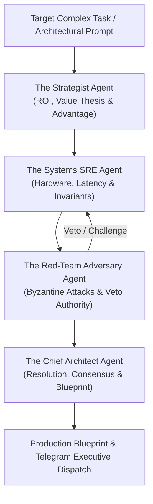

# 🐝 Sovereign Agent Swarm (Dialectic Deliberation Mesh)

[](https://github.com/Amz34/sovereign-agent-swarm)
[](https://github.com/Amz34)
[](https://github.com/Amz34)
[](https://github.com/Amz34/sovereign-agent-swarm)

Autonomous, multi-persona AI agent deliberation mesh executing adversarial debates, SRE hardware feasibility audits, and formal architectural consensus without human token burn.

Architected by **[Aamir Zameer (@Amz34)](https://github.com/Amz34)** (Principal AI Systems Architect, Az. Consultancy).

> [!TIP]
> **Enterprise Advisory & AI Architecture Engagements:**
> To deploy sovereign multi-agent consensus meshes, custom agentic workflows, or source vetted elite AI engineers:  
> 💬 **Direct Consultation & Requisitions:** [Connect via Telegram (@AzGem_Bot)](https://t.me/AzGem_Bot) | [GitHub Ecosystem](https://github.com/Amz34) | [Architecture Manifest](https://pastebin.com/6sH3kC7b)


---

## 🏛️ Swarm Dialectic Architecture



---

## 👥 The 4 Deliberating Agent Personas

1. **The Strategist (`THE_STRATEGIST`)**: Formulates the core value proposition, market differentiation, and non-linear leverage.
2. **The Systems SRE (`THE_SYSTEMS_SRE`)**: Enforces memory budgets, sub-millisecond latency SLOs, and thread/hardware bounds.
3. **The Red-Team Adversary (`RED_TEAM_ADVERSARY`)**: Possesses absolute **VETO power**; stress-tests edge failure modes, prompt injection, and state drift.
4. **The Chief Architect (`CHIEF_ARCHITECT`)**: Unifies the debate, patches adversarial findings, and authors formal Mermaid topologies.

---

## 📂 Autonomous Deliberation Blueprints

| Topic | Consensus Status | Dossier Access |
|:---|:---:|:---:|
| [Autonomous Self-Healing Agent Mesh with Zero-Egress Invariants](./dashboards/autonomous-self-healing-agent-mesh-with-zero-egress-invariants.md) | `Consensus Reached` | [`Read Deliberation Blueprint →`](./dashboards/autonomous-self-healing-agent-mesh-with-zero-egress-invariants.md) |

---

## 🛠️ CLI Operations

```bash
# Dispatch autonomous brainstorming & consensus deliberation:
./swarm_cli.py deliberate "Autonomous Micro-VM Sandboxing for AI Code Execution"

# Run deliberation with auto-commit and GitHub push:
./swarm_cli.py deliberate "Autonomous Micro-VM Sandboxing" --push

# View all deliberations:
./swarm_cli.py list
```

---

*Architected & Maintained by [Aamir Zameer (@Amz34)](https://github.com/Amz34) · Az. Consultancy Systems Lab.*

---

Part of [my always-on agent stack](https://github.com/Amz34) · [Awesome Agent Infrastructure](https://github.com/Amz34/awesome-agent-infrastructure) (135 live-checked building blocks).
